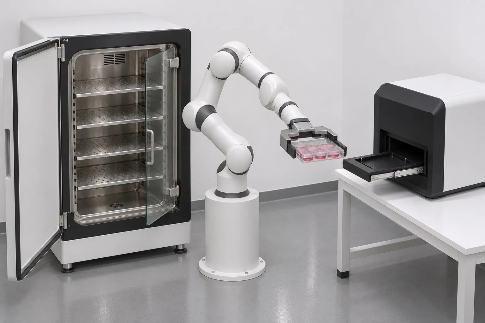

<p align="center">
  
</p>

# World Building

**A living pipeline for building physics-validated 3D scenes from a lab brief.**

Give it a request like "build me a lights-out cell-passaging lab" and it produces a MuJoCo simulation whose recorded rigid-body poses drive a Blender render. The motion is *computed*, never keyframed. Scripted gates check the work against thresholds that were frozen before it started.

<p align="center">
  <a href="https://github.com/CaiZongyuan/world-building/actions/workflows/site.yml"></a>
  <a href="https://caizongyuan.github.io/world-building/"></a>
  <a href="https://www.python.org/"></a>
  <a href="https://mujoco.readthedocs.io/"></a>
  <a href="https://www.blender.org/"></a>
</p>

<p align="center">
  <a href="README.zh-CN.md">简体中文</a> · <strong>English</strong> · <a href="https://caizongyuan.github.io/world-building/"><strong>Introduction &amp; tutorials ↗</strong></a>
</p>

---

> **Introduction site → [caizongyuan.github.io/world-building](https://caizongyuan.github.io/world-building/)**
> The tutorials live there, not in this README: a full walkthrough of how the pipeline is run, an interactive MuJoCo physics workbench you can run in the browser, command reference, review checklists, and both case studies with scrubbable films. The site is in Chinese and is rebuilt from `site/` on every push to `main`.



*Above: a concept reference. The finished motion is simulated in MuJoCo and rendered from those recorded poses, not animated by hand.*

## This repo is the pipeline — and the pipeline keeps changing

What lives here is the **process**, not the scenes: the [`lab-scene-pipeline` skill](.agents/skills/lab-scene-pipeline/SKILL.md) that drives the work, the `wb` CLI and its validation gates, the controlled vocabulary, the decision records, the lessons written up after each run, proposal templates and published proposal pages, and the tutorial site.

There is no final version of this process. Every project writes a stage log and a retrospective; whatever it teaches gets written back into [`docs/lessons/`](docs/lessons/), the skill, the gates and the site. Rules change because real work breaks them — kinematic preflight was added after a slice showed that most simulation reworks were reachability problems that should have been caught earlier. The commit history here is the revision history of the pipeline itself.

Two things that are *not* the same:

- **Thresholds are frozen per project.** Once a plan fixes its numbered limits, a gate never loosens them to make a FAIL go away. That is what makes a single result checkable.
- **The pipeline itself is never frozen.** The stages, the checks, the commands and the docs are all editable, and are expected to keep being edited.

Scene artifacts (`.blend`, MJCF, GLB, reference images, simulation results, films, stage logs) stay out of git, in the Hugging Face dataset [`RickC1999/world-building-projects`](https://huggingface.co/datasets/RickC1999/world-building-projects). That split is deliberate: see [ADR-0002](docs/adr/0002-pipeline-on-github-artifacts-on-huggingface.md). The other decisions — why physics comes before rendering, how the skill was grown from a small slice — are in [`docs/adr/`](docs/adr/).

## Quick start

Python 3.12+ and [`uv`](https://docs.astral.sh/uv/); the `sim` extra installs MuJoCo 3.3+. Blender 5.4 is an external tool used at render time.

```bash
git clone https://github.com/CaiZongyuan/world-building.git
cd world-building

uv sync --extra sim
uv run --extra sim pytest          # gates, each with positive and negative fixtures
```

The `wb` CLI ([`src/wb/`](src/wb/)) owns the project layout and the gates:

```bash
uv run wb new <project> --title "My lab"                      # scaffold a project
uv run --extra sim wb gate <project> <stage>                 # PASS / FAIL / NOT_RUN / BLOCKED / IDEALIZED
uv run --extra sim wb preflight <preflight.json> --out <dir> # kinematic feasibility check
uv run wb publish <project>                                  # publish the proposal preview
uv run wb review <project>                                   # build the review page
```

Input formats and the exact project contract are in [`docs/agents/project-layout.md`](docs/agents/project-layout.md). If the pipeline changes, the tutorial site changes with it — build it with `pnpm build` in `site/` before pushing.

## What's in here

| Path | Contents |
|---|---|
| [`.agents/skills/lab-scene-pipeline/`](.agents/skills/lab-scene-pipeline/) | The orchestration skill that runs a project |
| [`docs/lessons/`](docs/lessons/) | Lessons from each run — what to do, why, and the pits with evidence |
| [`docs/adr/`](docs/adr/) | Decision records; amended rather than treated as scripture |
| [`GLOSSARY.md`](GLOSSARY.md), [`AGENTS.md`](AGENTS.md) | Controlled vocabulary and working agreements |
| [`src/wb/`](src/wb/), [`tests/`](tests/) | `wb` CLI and gate fixtures |
| [`proposals/`](proposals/), [`templates/proposal/`](templates/proposal/) | Published proposal pages and their HTML/CSS theme |
| [`site/`](site/) | Tutorial site, interactive physics labs, case studies |

## Track record

The process has been exercised on real work, and those projects are what keep rewriting it: a [one-step vertical slice](https://caizongyuan.github.io/world-building/cases/slice-01) (54.0 s of continuous simulation, 0.09 mm max penetration, a 1,621-frame film) and a [full lights-out lab](https://caizongyuan.github.io/world-building/cases/full-lab) (14 protocol steps, 911.9 s chained simulation, 20/20 gates passing and 10/10 negative cases failing as expected). Both case pages also publish the failures, the idealized shortcuts and what remains unresolved — that is the raw material for the next revision.

## Stack

| Layer | Tools |
|---|---|
| Orchestration | Agent Skills (`SKILL.md`) |
| Physics | MuJoCo 3.3+, `MjSpec`, MJCF, Menagerie Panda, CPU |
| Visuals | Blender 5.4 (Cycles/OptiX), GLB, generated reference imagery → WebP |
| Tooling | Python 3.12+, `uv`, `wb` CLI, pytest |
| Docs | VitePress 1.6, pnpm, custom Vue components, MuJoCo WASM labs |
| Artifacts | Hugging Face datasets, GitHub Pages |

## Status

- Work in progress by design: expect the pipeline, the gates and the docs to keep moving. Prose in the repo is Chinese; code, filenames and identifiers are English. This README and its [Chinese counterpart](README.zh-CN.md) are the bilingual front door.
- Not a packaged library or a turnkey product. No license has been declared yet; contact the maintainer before reusing assets. Generated concept images and third-party reference material carry their own terms.

---

<p align="center">
  <a href="https://caizongyuan.github.io/world-building/">Introduction &amp; tutorials</a> · <a href="README.zh-CN.md">简体中文</a>
</p>
