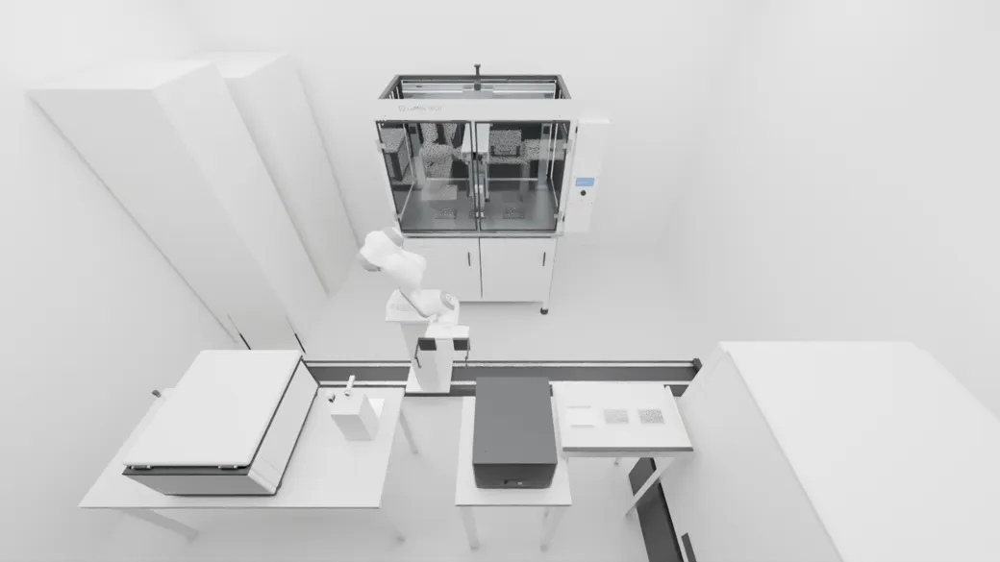
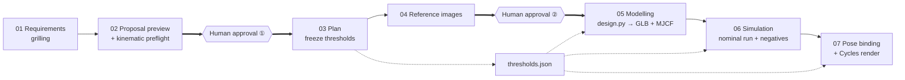

<p align="center">
  
</p>

# World Building

**From a one-line lab brief to a physics-validated 3D scene — and a film you can actually trust.**

A seven-stage pipeline that turns "build me a lights-out cell-passaging lab" into a MuJoCo simulation whose recorded rigid-body poses drive a Blender render. The motion is *computed*, never keyframed. Every stage is closed by a scripted validation gate against thresholds frozen before the work starts, and a human only has to show up twice.

<p align="center">
  <a href="https://github.com/CaiZongyuan/world-building/actions/workflows/site.yml"></a>
  <a href="https://caizongyuan.github.io/world-building/"></a>
  <a href="https://www.python.org/"></a>
  <a href="https://mujoco.readthedocs.io/"></a>
  <a href="https://www.blender.org/"></a>
</p>

<p align="center">
  <strong>English</strong> · <a href="README.zh-CN.md">简体中文</a> · <a href="https://caizongyuan.github.io/world-building/">Tutorial site ↗</a> · <a href="https://github.com/CaiZongyuan/world-building/issues">Issues ↗</a>
</p>

---

| What you ask for | What the pipeline delivers |
|:---:|:---:|
|  |  |
| *Concept reference image, produced during the proposal stage.* | *Blender/Cycles render whose every pose comes from MuJoCo.* |

## What this repository is

**This repo holds the process, not the scene files.** It contains the agent skill that orchestrates the work, the `wb` CLI and its validation gates, the frozen vocabulary and decision records, the stage-by-stage lessons learned from two real projects, proposal templates, published proposal pages, and a VitePress tutorial site with seven browser-runnable MuJoCo physics labs.

The heavy artifacts — `.blend`, MJCF, GLB, reference images, simulation results, renders, stage logs — live in a separate Hugging Face dataset ([`RickC1999/world-building-projects`](https://huggingface.co/datasets/RickC1999/world-building-projects)), mirrored locally under `projects/`. That split is deliberate: see [ADR-0002](docs/adr/0002-pipeline-on-github-artifacts-on-huggingface.md).

### Why a fixed pipeline at all

Two earlier approaches failed in instructive ways:

- **Hand-keyframed Blender animation** looked fine but hid clipping, plates passing through benches, and grippers that never really held anything. Rejected in [ADR-0003](docs/adr/0003-physics-first-then-pose-bind-render.md).
- **One monolithic "reference board to delivery" skill** was slow, failed often, and — worst of all — made it impossible to tell *which stage* was to blame. A historical scene claimed PASS but could not be reproduced from its archive.

So the pipeline rests on three rules, all of which grew out of a one-process-step **vertical slice** that walked every stage and recorded the real cost of each ([ADR-0001](docs/adr/0001-grow-new-skill-from-vertical-slice.md)):

1. **Physics first, rendering second.** All motion comes from MuJoCo. Blender copies recorded poses frame by frame; not one frame is adjusted by hand.
2. **Every stage passes a gate.** Acceptance thresholds are numbered and frozen in the plan stage; gates only read them. A FAIL means fix the design, never loosen the threshold.
3. **Humans decide direction, agents decide engineering.** You decide what to build, how faithful it must be, and what it should look like. Dimensions, fixtures, layout and control parameters are researched and decided by the agent, with reasons and evidence written down.

## The seven stages



Every stage also ends with `uv run --extra sim wb gate <project> <stage>`. The two diamonds are the only formal human approvals; the requirements stage includes a short scope review of three checklists (scene, process, assets).

| # | Stage | Question it answers | Main artifact |
|---:|---|---|---|
| 01 | Requirements grilling | What is in scope, who performs it, how faithful, what compute budget? | `01-requirements/requirements.md` (six fixed sections) |
| 02 | Proposal preview | Is the layout, grip and reach *actually* feasible? | `02-proposal/index.html`, `preflight.json` → report + top view |
| 03 | Plan | What exactly counts as "done"? | `03-plan/plan.md` + **`thresholds.json`** (S/M/R/V gates, negatives N) |
| 04 | Reference images | What should it look like? | reference board, `dimensions.md`, `load_path.svg` |
| 05 | Modelling | One parameter source, two models | `design.py` → GLB (visual) + MJCF (physics) + `mapping.json` |
| 06 | Simulation | Does the motion survive real contact physics? | nominal run + negative runs, `results/*.json`, `states_30fps.npz` |
| 07 | Pose binding & render | Does the film show exactly what was simulated? | `film.mp4` + keyframes, uncut and unsped-up |

Note the vocabulary: a **stage** is a segment of the pipeline; a **process step** is a step of the lab protocol. The full lab has 7 stages and 14 process steps. All terms are pinned in [`GLOSSARY.md`](GLOSSARY.md).

## What makes the result checkable

- **Frozen thresholds + negative cases.** Plan writes numbered limits into `thresholds.json` with a freeze date. If a measurement misses, the design or the measurement code changes — the limit does not. Each gate ships with positive *and* negative fixtures in [`tests/fixtures/`](tests/fixtures/), and every negative variant must be judged FAIL; otherwise the gate is broken, not passing. A negative is only designed after a **hazard probe** confirms the danger it targets can really occur.
- **IDEALIZED never counts as PASS.** Steps that skip real contact physics (e.g. a weld standing in for a grip on a few-gram part) are allowed, but are labelled, guarded by their own thresholds, and disclosed in the film and report.
- **Five gate results:** `PASS · FAIL · NOT_RUN · BLOCKED · IDEALIZED`. FAIL dominates, then BLOCKED, NOT_RUN and IDEALIZED; only an all-clear is PASS. Results and evidence paths are written to `gates/<stage>.json`.
- **One fixed rhythm per stage:** stage brief → artifacts → gate → stage log + lessons → sync. `stage-log.md` records measured time, agent turns, gate failures, rework and human interventions; it contains **no time estimates**. Those logs are what revealed that 9 of 14 simulation reworks in the first slice were really kinematic problems that should have been caught in stage 02 — which is why kinematic preflight exists.
- **Difficulty levels L1–L5**, from rigid-body placement to liquids (symbolic only), are assigned to every process step and device in the proposal, so the risky parts are visible before anyone builds a mesh.

## Quick start

Requirements: Python 3.12+, [`uv`](https://docs.astral.sh/uv/). The `sim` extra installs MuJoCo 3.3+. Node 24 + pnpm are only needed for the tutorial site; Blender 5.4 is an external tool used at render time.

```bash
git clone https://github.com/CaiZongyuan/world-building.git
cd world-building

uv sync --extra sim
uv run --extra sim pytest          # gate tests, each with positive + negative fixtures
```

The `wb` CLI ([`src/wb/`](src/wb/)) implements the project directory contract and the validation gates:

```bash
uv run wb new <project> --title "My lights-out lab"          # scaffold a project, never by hand
uv run --extra sim wb gate <project> requirements            # requirements proposal plan reference modelling simulation render
uv run --extra sim wb preflight <preflight.json> --out <dir> # box-proxy IK, gripper sweep, mover sweep
uv run wb publish <project>                                  # copy 02-proposal/ into proposals/<name>/
uv run wb review <project>                                   # build the checkpoint-② review page
```

`wb gate` exits 0 only on PASS. `wb preflight` is a seconds-scale kinematic check — no dynamics — that catches unreachable poses, gripper stroke shortfalls and door/base collisions *before* simulation. Its input format is documented in [`docs/agents/project-layout.md`](docs/agents/project-layout.md).

To work on the tutorial site:

```bash
cd site
pnpm install
pnpm dev        # http://127.0.0.1:5292/world-building/
pnpm build
```

Pushing to `main` automatically builds and publishes it to [GitHub Pages](https://caizongyuan.github.io/world-building/) via [`.github/workflows/site.yml`](.github/workflows/site.yml). If the pipeline changes, the site changes with it.

### Where a project lives

```
<project>/
├── README.md, stage-log.md, gates/<stage>.json
├── 01-requirements/   requirements.md
├── 02-proposal/       index.html + img/ + preflight.json
├── 03-plan/           plan.md + thresholds.json
├── 04-reference/      reference board, dimensions.md, load_path.svg
├── 05-modelling/      design.py → GLB + MJCF + mapping.json
├── 06-simulation/     nominal + negatives, states_30fps.npz
└── 07-render/         film.mp4, keyframes
```

Projects are synced with `hf upload` / `hf download` against the dataset; HF does not store empty directories, so a freshly pulled project legitimately reports `NOT_RUN` for stages that do not exist yet.

## What's in this repo

| Path | Contents |
|---|---|
| [`.agents/skills/lab-scene-pipeline/`](.agents/skills/lab-scene-pipeline/) | The orchestration skill: all seven stages, phased large projects, project wrap-up |
| [`docs/lessons/`](docs/lessons/) | One lesson per stage — what to do, why, and the pits with evidence — plus the vertical-slice retrospective |
| [`docs/adr/`](docs/adr/) | Three decision records: how the skill was grown, the artifact split, physics-before-render |
| [`docs/agents/`](docs/agents/) | Agent conventions: project layout, image generation, issue tracker, triage labels, domain docs |
| [`GLOSSARY.md`](GLOSSARY.md), [`AGENTS.md`](AGENTS.md) | Controlled vocabulary and the working agreements for this repo |
| [`src/wb/`](src/wb/), [`tests/`](tests/) | `wb` CLI (gate / new / publish / review / preflight) and gate fixtures |
| [`proposals/`](proposals/) | Published proposal previews, scope previews and checkpoint-② review pages for both projects |
| [`templates/proposal/`](templates/proposal/) | HTML/CSS theme used by proposal pages (light + dark) |
| [`site/`](site/) | VitePress tutorial, interactive gates/physics labs, film scrubbing, case studies |
| [`site/labs/labs.json`](site/labs/labs.json) | Seven MuJoCo experiments shared by the browser (WASM), `play.py` and `runner.py` |

## Two real projects, with the receipts

| | [Vertical slice 01](https://caizongyuan.github.io/world-building/cases/slice-01) · open incubator, take plate | [Full lights-out lab](https://caizongyuan.github.io/world-building/cases/full-lab) · 14-step cell passaging |
|---|---|---|
| Purpose | One process step through all seven stages, to measure the pipeline itself | First full project built with the resulting skill; agent ran autonomously |
| Continuous simulation | 54.0 s | 911.9 s across four phases + a chained full run |
| Gates | S1–S13 all PASS; N1–N3 v2 FAIL as expected | 20/20 PASS; 10/10 negatives FAIL as expected |
| Max penetration | 0.09 mm | 0.219 mm (limit 0.25 mm); zero robot–equipment collisions |
| Film | 1,621 frames, draft preset, 16.3 min render | Phase 1 film (3,226 frames) rendered and gated; the ~27k-frame full film is still rendering |
| What it taught us | 9 of 14 simulation reworks were kinematic → preflight added to stage 02 | Asset audits beat spec sheets; phased integration needs the *complete* `mjData` state |

Both case pages publish the failures, the idealized parts and the unresolved issues, not just the highlights. That is the point of the stage log.

## Learn the pipeline

The [tutorial site](https://caizongyuan.github.io/world-building/) is the front door (it is written in Chinese, as are most in-repo docs):

- [One-page overview](https://caizongyuan.github.io/world-building/guide/) · [Core concepts](https://caizongyuan.github.io/world-building/guide/concepts) · [Who decides what](https://caizongyuan.github.io/world-building/guide/roles)
- [The seven stages](https://caizongyuan.github.io/world-building/stages/requirements), one page each
- [Physics workbench](https://caizongyuan.github.io/world-building/physics/) — seven MuJoCo experiments that run in your browser (WASM, with precomputed replay fallback)
- [Using the skill](https://caizongyuan.github.io/world-building/skill/) · [command reference](https://caizongyuan.github.io/world-building/skill/commands) · [review checklist](https://caizongyuan.github.io/world-building/skill/review) · [self-test quiz](https://caizongyuan.github.io/world-building/skill/quiz)
- [Case studies](https://caizongyuan.github.io/world-building/cases/slice-01) with scrubbable films

To start a new project, use the skill [`lab-scene-pipeline`](.agents/skills/lab-scene-pipeline/SKILL.md). It encodes the two approval checkpoints, the rule that engineering details are never bounced back to the user, the fixed five-step rhythm per stage, and the wrap-up that writes new lessons back into the skill and the site.

## Stack

| Layer | Tools |
|---|---|
| Orchestration | Agent Skills (`SKILL.md`), GitHub Issues + `gh`, five triage labels |
| Physics | MuJoCo 3.3+, `MjSpec`, MJCF, Menagerie Panda, weld constraints, CPU |
| Visuals | Blender 5.4 (Cycles/OptiX), GLB, generated reference imagery → WebP |
| Tooling | Python 3.12+, `uv`, `wb` CLI, pytest with positive/negative fixtures |
| Docs | VitePress 1.6, pnpm, custom Vue components, MuJoCo WASM labs |
| Artifacts | Hugging Face datasets, GitHub Pages |

## Conventions and status

- Prose is written in Chinese; code, filenames and identifiers are English. This README and its [Chinese counterpart](README.zh-CN.md) are the bilingual front door.
- Terms are fixed in [`GLOSSARY.md`](GLOSSARY.md); decisions are recorded in [`docs/adr/`](docs/adr/). Issues and specs live in GitHub Issues; see [`docs/agents/issue-tracker.md`](docs/agents/issue-tracker.md) and [`docs/agents/triage-labels.md`](docs/agents/triage-labels.md).
- This is an active research workflow, not a packaged library or a turnkey product. No license has been declared yet; contact the maintainer before reusing assets, and note that generated concept images and third-party reference material carry their own terms.
- The tutorial site is deployed from `main`; if you change a stage, a gate, a command or a rule, update `site/` in the same change.

---

<p align="center">
  <a href="https://caizongyuan.github.io/world-building/">Documentation</a> · <a href="README.zh-CN.md">简体中文</a> · <a href="https://github.com/CaiZongyuan/world-building/issues">Issues</a>
</p>
