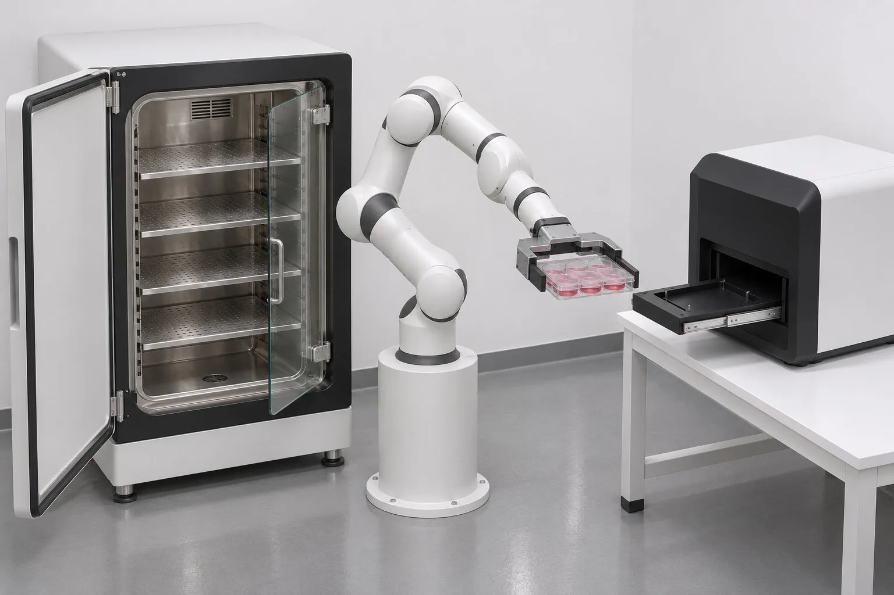
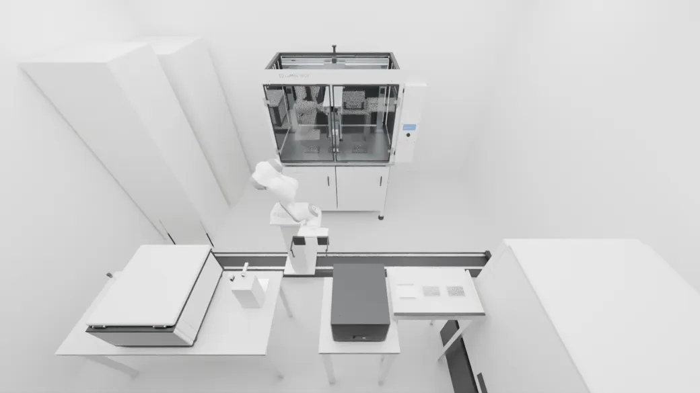
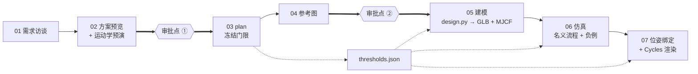

<p align="center">
  
</p>

# World Building · 场景流程

**从一句实验室需求，到一段经过物理验证的成片。**

一条七个阶段的流程，把「做一个细胞传代黑灯实验室」这样的需求，变成 MuJoCo 里跑出来的仿真：记录下来的刚体位姿逐帧驱动 Blender 渲染。动作是**算出来的**，不是手 K 的。每个阶段都由脚本对照开工前冻结的门限判定完成与否，而人只需要在两处出场。

<p align="center">
  <a href="https://github.com/CaiZongyuan/world-building/actions/workflows/site.yml"></a>
  <a href="https://caizongyuan.github.io/world-building/"></a>
  <a href="https://www.python.org/"></a>
  <a href="https://mujoco.readthedocs.io/"></a>
  <a href="https://www.blender.org/"></a>
</p>

<p align="center">
  <a href="README.md"><strong>English</strong></a> · <strong>简体中文</strong> · <a href="https://caizongyuan.github.io/world-building/">教程站点 ↗</a> · <a href="https://github.com/CaiZongyuan/world-building/issues">Issues ↗</a>
</p>

---

| 你提出的需求 | 流程交付的结果 |
|:---:|:---:|
|  |  |
| *方案预览阶段生成的参考图，只冻结外观风格。* | *Blender/Cycles 渲染：每一帧位姿都来自 MuJoCo。* |

## 这个仓库里有什么

**本仓库只放流程本身，不放场景产物。** 这里有调度全流程的 agent skill、`wb` 命令行与验证门、受控术语表与决策记录、两个真实项目逐阶段沉淀的经验记录、方案预览模板与已发布的方案页，以及一个带七个可在浏览器中运行 MuJoCo 实验台的 VitePress 教程站点。

重资产（`.blend`、MJCF、GLB、参考图、仿真结果、成片、阶段日志）放在单独的 Hugging Face 数据集 [`RickC1999/world-building-projects`](https://huggingface.co/datasets/RickC1999/world-building-projects)，本地镜像在 `projects/`。这个划分是刻意的，见 [ADR-0002](docs/adr/0002-pipeline-on-github-artifacts-on-huggingface.md)。

### 为什么需要一条固定流程

之前试过两种做法，都以有启发性的方式失败了：

- **在 Blender 里手 K 动画**：画面好看，但看不出穿模、板子穿进台面、夹爪根本没夹住。已被 [ADR-0003](docs/adr/0003-physics-first-then-pose-bind-render.md) 否决。
- **一个从参考板一路做到交付的大而全 skill**：慢、问题多，最要命的是**看不出是哪个阶段出的问题**。某个历史场景宣称 PASS，却无法从归档复现。

于是流程定了三条原则。它们不是拍脑袋写的，而是来自一个只含**一个工艺步骤**、却走完全部阶段的**薄切片**：逐阶段记下卡点和真实成本，再提炼成 skill（[ADR-0001](docs/adr/0001-grow-new-skill-from-vertical-slice.md)）。

1. **先物理，后渲染。** 运动一律由 MuJoCo 产生，Blender 逐帧照抄记录的位姿，不加一帧手调。
2. **每个阶段都要过门。** 「做成了」的标准在 plan 阶段编号并冻结，验证门只读它。判 FAIL 就改设计，绝不放宽门限。
3. **人决定方向，agent 决定工程细节。** 你决定做什么、做到多真、看起来像什么；尺寸、夹具、布局、控制参数由 agent 查证后自己决定，并写清理由和证据。

## 七个阶段



每个阶段还要跑一次 `uv run --extra sim wb gate <项目> <阶段>`。图中两个菱形是仅有的正式审批点；需求访谈里另有一次简短的范围确认（场景、流程、资产三张清单）。

| # | 阶段 | 回答什么问题 | 主要产物 |
|---:|---|---|---|
| 01 | 需求访谈 | 范围有多大、谁来做、做到多真、算力预算多少？ | `01-requirements/requirements.md`（固定六节） |
| 02 | 方案预览 | 布局、夹持、可达性**到底行不行**？ | `02-proposal/index.html`、`preflight.json` → 报告 + 俯视图 |
| 03 | plan | 究竟怎样才算「做完了」？ | `03-plan/plan.md` + **`thresholds.json`**（S/M/R/V 门限、负例 N） |
| 04 | 参考图 | 它应该长什么样？ | 参考板、`dimensions.md`、`load_path.svg` |
| 05 | 建模 | 一个参数源，两份模型 | `design.py` → GLB（视觉）+ MJCF（物理）+ `mapping.json` |
| 06 | 仿真 | 动作在真实接触物理下站得住吗？ | 名义流程 + 负例、`results/*.json`、`states_30fps.npz` |
| 07 | 位姿绑定与渲染 | 成片是否忠实于仿真？ | `film.mp4` + 关键帧，不加速、不剪辑 |

注意术语：**阶段**是流程的一段，**工艺步骤**是实验工艺的一步。全流程实验室有 7 个阶段、14 个工艺步骤。所有用词以 [`GLOSSARY.md`](GLOSSARY.md) 为准。

## 结果为什么可信

- **门限冻结 + 负例。** plan 把带编号的门限连同冻结日期写进 `thresholds.json`。实测不达标，改设计或改测量代码，不改门限。每道门在 [`tests/fixtures/`](tests/fixtures/) 都配有正例和负例夹具；负例必须被判 FAIL，否则说明门限失效而不是场景通过。设计负例前还要先做**危险探针**，确认它针对的危险在操作范围内真的会发生。
- **IDEALIZED 永远不算 PASS。** 跳过真实接触物理的步骤（例如几克重的小件用 weld 代表「已夹住」）允许使用，但必须标注、由门限盯住，并在报告和成片里如实说明。
- **五种判定**：`PASS · FAIL · NOT_RUN · BLOCKED · IDEALIZED`。FAIL 优先，其次 BLOCKED、NOT_RUN、IDEALIZED，全部通过才是 PASS。判定与证据路径写入 `gates/<阶段>.json`。
- **每个阶段同一套动作**：阶段说明 → 产物 → 验证门 → 阶段日志 + 经验记录 → 同步。`stage-log.md` 只记实测耗时、agent 轮数、门失败、返工和人工介入，**不写时间预估**。正是靠它发现：薄切片 01 的 14 次仿真返工中有 9 次其实是运动学问题，本该在阶段 02 发现——运动学预演就是这么来的。
- **难度等级 L1–L5**，从刚体放置到液体（只能符号化），在方案预览里逐步骤、逐设备标注，让风险在建网格之前就可见。

## 快速开始

环境：Python 3.12+、[`uv`](https://docs.astral.sh/uv/)；`sim` extra 会装 MuJoCo 3.3+。Node 24 + pnpm 只用于教程站点，Blender 5.4 是渲染阶段调用的外部工具。

```bash
git clone https://github.com/CaiZongyuan/world-building.git
cd world-building

uv sync --extra sim
uv run --extra sim pytest          # 每道门都有正例和负例夹具
```

`wb` 命令行（[`src/wb/`](src/wb/)）实现项目目录契约和验证门：

```bash
uv run wb new <项目> --title "我的黑灯实验室"            # 按契约建项目骨架，不要手工拼目录
uv run --extra sim wb gate <项目> requirements           # requirements proposal plan reference modelling simulation render
uv run --extra sim wb preflight <preflight.json> --out <目录>  # 方盒代理 IK、夹爪行程、活动件扫掠
uv run wb publish <项目>                                 # 把 02-proposal/ 复制到 proposals/<项目名>/
uv run wb review <项目>                                  # 生成审批点②页面 04-reference/index.html
```

`wb gate` 只有 PASS 时退出码才是 0。`wb preflight` 是几秒级的运动学检查，不跑动力学，用来在仿真之前抓出不可达位姿、夹爪行程不足、门扫到底座这类问题。输入格式见 [`docs/agents/project-layout.md`](docs/agents/project-layout.md)。

改教程站点：

```bash
cd site
pnpm install
pnpm dev        # http://127.0.0.1:5292/world-building/
pnpm build
```

推送到 `main` 后，[`.github/workflows/site.yml`](.github/workflows/site.yml) 会自动构建并发布到 [GitHub Pages](https://caizongyuan.github.io/world-building/)。流程变了，站点要同步改。

### 项目目录长什么样

```
<项目名>/
├── README.md、stage-log.md、gates/<阶段>.json
├── 01-requirements/   requirements.md
├── 02-proposal/       index.html + img/ + preflight.json
├── 03-plan/           plan.md + thresholds.json
├── 04-reference/      参考板、dimensions.md、load_path.svg
├── 05-modelling/      design.py → GLB + MJCF + mapping.json
├── 06-simulation/     名义流程 + 负例、states_30fps.npz
└── 07-render/         film.mp4、关键帧
```

项目用 `hf upload` / `hf download` 与数据集同步。HF 不保存空目录，所以刚拉下来的项目缺某个阶段目录很正常，对应验证门判 `NOT_RUN`。

## 仓库结构

| 路径 | 内容 |
|---|---|
| [`.agents/skills/lab-scene-pipeline/`](.agents/skills/lab-scene-pipeline/) | 调度 skill：七个阶段、大项目分期、项目收尾 |
| [`docs/lessons/`](docs/lessons/) | 每阶段一份经验记录：做什么、为什么、踩过的坑（附证据），另附薄切片 01 汇总复盘 |
| [`docs/adr/`](docs/adr/) | 三份决策记录：skill 如何从薄切片长出来、产物为何分开存、先物理后渲染 |
| [`docs/agents/`](docs/agents/) | agent 约定：项目目录、图片生成、issue tracker、标签、领域文档 |
| [`GLOSSARY.md`](GLOSSARY.md)、[`AGENTS.md`](AGENTS.md) | 受控术语与本仓库的工作约定 |
| [`src/wb/`](src/wb/)、[`tests/`](tests/) | `wb` 命令行（gate / new / publish / review / preflight）与验证门夹具 |
| [`proposals/`](proposals/) | 两个项目已发布的方案预览、范围预览、审批点②页面 |
| [`templates/proposal/`](templates/proposal/) | 方案页用的 HTML/CSS 主题（浅色 + 深色） |
| [`site/`](site/) | VitePress 教程、交互式验证门与物理实验台、成片拖动查看、案例页 |
| [`site/labs/labs.json`](site/labs/labs.json) | 七个 MuJoCo 实验，网页（WASM）、`play.py`、`runner.py` 共用同一份定义 |

## 两个真实项目，附实测数据

| | [薄切片 01](https://caizongyuan.github.io/world-building/cases/slice-01) · 开箱取板 | [全流程黑灯实验室](https://caizongyuan.github.io/world-building/cases/full-lab) · 14 步传代 |
|---|---|---|
| 目的 | 一个工艺步骤走完全部七阶段，用来量流程本身的成本 | 用提炼出的 skill 做的第一个完整项目，全程 agent 自主推进 |
| 连续仿真 | 54.0 s | 911.9 s，四期接力 + 一次全流程连跑 |
| 门限 | S1–S13 全部 PASS；N1–N3 v2 按预期 FAIL | 20/20 PASS；10/10 负例按预期 FAIL |
| 最大穿透 | 0.09 mm | 0.219 mm（门限 0.25 mm）；机器人碰设备 0 次 |
| 成片 | 1,621 帧，draft 档位，渲染 16.3 min | 期 1 成片（3,226 帧）已渲染并过门；约 2.7 万帧的全片仍在渲染 |
| 换来的经验 | 14 次仿真返工有 9 次是运动学问题 → 阶段 02 加入预演 | 资产要实查而不是读说明；分期集成必须存下完整的 `mjData` 状态 |

两个案例页都把失败、理想化处理和遗留问题一并公开，而不只是展示高光——阶段日志的意义就在这里。

## 怎么学这条流程

[教程站点](https://caizongyuan.github.io/world-building/) 是入口（站内和仓库内多数文档为中文）：

- [一页看懂整个流程](https://caizongyuan.github.io/world-building/guide/) · [核心概念](https://caizongyuan.github.io/world-building/guide/concepts) · [谁决定什么](https://caizongyuan.github.io/world-building/guide/roles)
- [七个阶段](https://caizongyuan.github.io/world-building/stages/requirements)，每阶段一页
- [物理实验台](https://caizongyuan.github.io/world-building/physics/)：七个在浏览器里跑的 MuJoCo 实验（WASM，加载失败时切预计算回放）
- [用好 skill](https://caizongyuan.github.io/world-building/skill/) · [命令速查](https://caizongyuan.github.io/world-building/skill/commands) · [审批时看什么](https://caizongyuan.github.io/world-building/skill/review) · [自测](https://caizongyuan.github.io/world-building/skill/quiz)
- [案例页](https://caizongyuan.github.io/world-building/cases/slice-01)，可拖动查看成片关键帧

新建或推进项目用 skill [`lab-scene-pipeline`](.agents/skills/lab-scene-pipeline/SKILL.md)。它写明了两个审批点、工程细节不回抛给用户、每阶段固定的五步动作，以及收尾时把新经验回写进 skill 和站点。

## 技术栈

| 层 | 工具 |
|---|---|
| 调度 | Agent Skills（`SKILL.md`）、GitHub Issues + `gh`、五个分流标签 |
| 物理 | MuJoCo 3.3+、`MjSpec`、MJCF、Menagerie Panda、weld 约束、CPU |
| 视觉 | Blender 5.4（Cycles/OptiX）、GLB、生成参考图 → WebP |
| 工具链 | Python 3.12+、`uv`、`wb` 命令行、pytest 正例/负例夹具 |
| 文档 | VitePress 1.6、pnpm、自定义 Vue 组件、MuJoCo WASM 实验台 |
| 产物 | Hugging Face 数据集、GitHub Pages |

## 约定与状态

- 正文用中文，代码、文件名、标识符用英文。本 README 与 [英文版](README.md) 是这扇双语门。
- 术语固定在 [`GLOSSARY.md`](GLOSSARY.md)，决策记在 [`docs/adr/`](docs/adr/)。Issues 和 spec 放 GitHub Issues，见 [`docs/agents/issue-tracker.md`](docs/agents/issue-tracker.md) 与 [`docs/agents/triage-labels.md`](docs/agents/triage-labels.md)。
- 这是一套在用的研究流程，不是打包好的库或开箱即用产品。目前尚未声明许可证；复用资产前请联系维护者，生成的参考图与第三方素材也各有其许可条款。
- 教程站点从 `main` 自动发布；改动阶段、验证门、命令或规则时，请在同一处改动里同步更新 `site/`。

---

<p align="center">
  <a href="https://caizongyuan.github.io/world-building/">教程站点</a> · <a href="README.md">English</a> · <a href="https://github.com/CaiZongyuan/world-building/issues">Issues</a>
</p>
